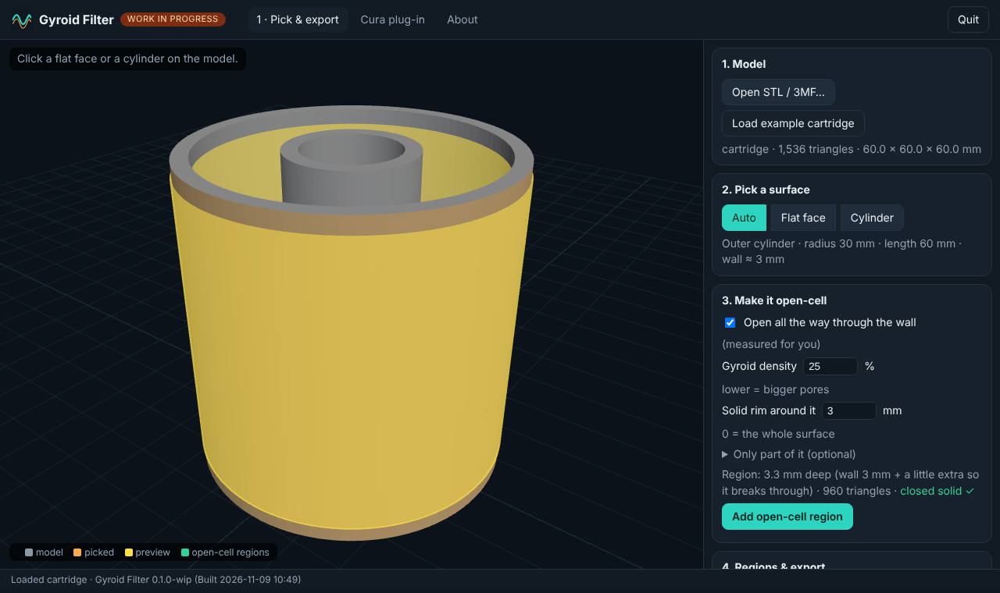
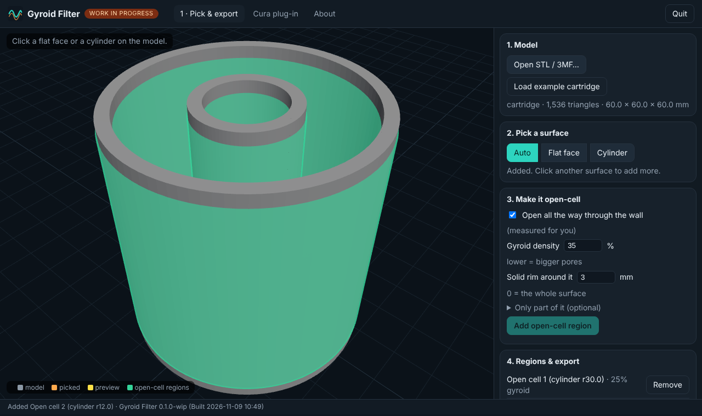

**WORK IN PROGRESS: MANY FEATURES MAY BE BROKEN** · proof of concept · version 0.1.0-wip

> Source-available, **non-commercial** ([PolyForm Noncommercial 1.0.0](LICENSE.md)). Provided as is, **no warranty and no liability**. Not a medical or safety device: check that a printed filter suits what you filter. PLA and PETG are not rated for food, chemicals or heat.

📘 [The whole manual and research notes as one PDF](docs/Gyroid-Filter-manual.pdf)

# Gyroid Filter

Pick a **flat face** or a **cylinder** on a model and make part or all of it **open-cell gyroid**, for printing **fillable carbon filters**. The gyroid replaces the solid wall, so air can pass through while the carbon granules stay inside.

It works with **Cura**, **PrusaSlicer** and **OrcaSlicer**:

| Slicer | How you use it |
|---|---|
| **Cura** | A plug-in adds a *Gyroid Filter* tool. Select the model, pick the tool, click a face or cylinder. |
| **PrusaSlicer** | Pick in the app, press *PrusaSlicer 3MF*, open the file. The open-cell regions are already there as modifiers. |
| **OrcaSlicer** | Same, with *OrcaSlicer 3MF* (see [what is tested](#what-is-tested-and-what-is-not)). |

PrusaSlicer and OrcaSlicer have no plug-in system that can pick faces, so for them the companion app does the picking and hands the slicer a normal 3MF. Your original model is never changed.

## Quick start (no terminal needed)

1. Unzip, and **double-click** the launcher for your computer:
   - Linux: `GyroidFilter-Linux.sh` (choose *Run* or *Run in Terminal*)
   - Windows: `GyroidFilter-Windows.bat`
   - Mac: `GyroidFilter-Mac.command` (first time: right-click, then *Open*, because it is unsigned)
2. Your browser opens. Press **Load example cartridge** (or open your own STL/3MF).
3. **Click** a face or a cylinder on the model. The picked surface turns orange; a yellow preview shows the region that will become open-cell.
4. Press **Add open-cell region**. Repeat for other surfaces.
5. Press **PrusaSlicer 3MF**, **OrcaSlicer 3MF** or **Region STLs**, and open the file in your slicer. For Cura see below.

Needs Python 3.8 or newer (nothing else; no packages to install). The launcher says what to do if Python is missing.

## What the options mean

| Option | What it does |
|---|---|
| **Open all the way through the wall** (default) | Measures the wall thickness under the picked surface and makes the region that deep, plus 0.3 mm so it breaks through. For a filter wall this is what lets air cross. Untick to choose a depth. |
| **Gyroid density** (5–60 %) | The slicer's infill density inside the region. Lower means bigger pores. How big the pores are for a given density is not measured yet: print a small test piece with your nozzle and your carbon before you commit. |
| **Solid rim** (mm) | Leaves a solid frame around the open area (for a cylinder: at both ends) so the part keeps its strength and has somewhere to glue or seal. 0 = the whole surface. |
| **Only part of it** | Limits the region to a window on a flat face (rectangle or oval, in % of the face), or to a stretch along and around a cylinder. |

"Open-cell" here means the region is printed with **no walls, no top or bottom skin and no "small area becomes solid" rule**, so the gyroid strands *are* the surface.

### The settings it applies

| | Cura (cutting mesh) | PrusaSlicer (modifier) | OrcaSlicer (modifier) |
|---|---|---|---|
| Pattern | `infill_pattern` = gyroid | `fill_pattern` = gyroid | `sparse_infill_pattern` = gyroid |
| Density | `infill_sparse_density` | `fill_density` | `sparse_infill_density` |
| Walls | `wall_line_count` = 0 | `perimeters` = 0 | `wall_loops` = 0 |
| Top/bottom skin | `top_layers`, `bottom_layers` = 0 | `top_solid_layers`, `bottom_solid_layers`, `*_solid_min_thickness` = 0 | `top_shell_layers`, `bottom_shell_layers`, `*_shell_thickness` = 0 |
| Small areas | `min_infill_area` = 0 | `solid_infill_below_area` = 0 | `minimum_sparse_infill_area` = 0 |

If a 3MF does not do what you want in your slicer, you can do the same by hand: add the **Region STLs** as modifiers and set these five things.

## Cura

1. In the app open the **Cura plug-in** tab, press **Install** next to your Cura version, restart Cura.
2. In Cura: select your model, choose the **Gyroid Filter** tool in the left toolbar, and click a face or cylinder.
3. The region appears as a child of the model (a *cutting mesh* carrying the settings above). **Slice**, then look at the layer view.
4. Change density or rim in the tool panel and press **Re-apply to last pick**; **Remove gyroid regions** clears them.

Cura's log (`cura.log`) gets a line `GyroidFilter: core self-test PASS` when the plug-in loads; the Cura tab in the app reads it and shows a green tick.

## What is tested, and what is not

| Part | Status |
|---|---|
| Face and cylinder detection, region solids, thickness probe | ✅ unit tests on the example cartridge, boxes, a half-pipe and a finely tessellated cylinder |
| **PrusaSlicer** 3MF | ✅ sliced in a real PrusaSlicer 2.7.2: inside the region only gyroid-style infill, no perimeters; above the rim normal walls; flat oval window in a plate also checked |
| **OrcaSlicer** 3MF | ⚠️ **not opened in Orca yet.** Written to Orca's own layout by reading Orca's importer source and its setting names. If it misbehaves, use the Region STLs route |
| **Cura plug-in** | ✅ **Tested by the author in a real Cura on Linux Mint: it works well.** Also tested against stand-ins for Cura's API, and every Cura setting name is checked against Cura's `fdmprinter.def.json`. Windows and Mac are not tested yet. Please report what happens on your setup |
| Web app | ✅ driven in headless Chrome (pick, preview, add, export, Cura tab): no JavaScript errors |
| Linux launcher | ✅ run for real. **Windows and Mac launchers were not run** |
| Printing a filter | ❌ nothing has been printed or filtered with this yet. Pore size versus density is unmeasured |
| 7th-gen Core i3 | ⚠️ not measured on one. On the 2-core test machine a 200,000-triangle model loads and picks in about a second and needs about 200 MB; see [DESIGN_NOTES.md](DESIGN_NOTES.md#measurements) |

## Known limitations

- Picks **flat faces and true cylinders** (holes and outer surfaces, full or partial arcs). Cones, spheres and free-form surfaces are not recognised.
- It does not design the filter housing, the fill port or the lid. It only makes the chosen walls open-cell.
- 3MF files are read for geometry only; modifiers and settings inside them are ignored. Open your original STL, or export STL from your CAD.
- Both slicers still print a thin boundary wall where the open-cell region meets the rest of the part (inside the part, never on the surface you picked).
- The 3MF is placed on a default bed centre (Prusa 125,105; Orca 128,128). If it sits off your bed, press **A** (arrange) in the slicer or set the bed centre in the app.
- Very big models are refused with a message if they will not fit in free memory.

## Troubleshooting

| Problem | What to try |
|---|---|
| Launcher says Python is missing | Install Python 3.8+ (the message tells you how), then double-click again |
| Browser did not open | Copy the `http://127.0.0.1:…` address printed in the launcher window |
| Click does nothing | Wait for the *Finding the surface* box to finish; on a big model it can take a few seconds |
| "No cylinder found" | You chose *Cylinder* on something that is not one; use *Auto* or *Flat face* |
| Region shows **NOT closed** | The picked surface has holes or overlaps; pick a neighbouring surface |
| Orca 3MF opens as one solid | Use **Region STLs** and add them as modifiers by hand |
| Cura tab shows no Cura | Start Cura once so it creates its folder, then press *Look for Cura again* |
| Cura loads it but shows no tool | Open `cura.log` and look for `GyroidFilter`; please report the line |

## More

- [HOW_IT_WORKS.md](HOW_IT_WORKS.md): what it reads, changes and never does
- [DESIGN_NOTES.md](DESIGN_NOTES.md): research notes, decisions, rejected ideas, measurements
- [CHANGELOG.md](CHANGELOG.md) · [docs/HISTORY.md](docs/HISTORY.md) · [THIRD_PARTY.md](THIRD_PARTY.md) · [CONTRIBUTING.md](CONTRIBUTING.md) · [SECURITY.md](SECURITY.md)

Related projects by the same author: [flatlock](https://github.com/The-Dorkknight/flatlock) / Shift-LoK (interlocking walls for the same three slicers) and [cura-hybrid-supports](https://github.com/The-Dorkknight/cura-hybrid-supports) (another Cura plug-in). This project shares their approach of working inside the slicer's own settings rather than rewriting G-code.

Project started 2026-11-09 09:55. Built by Matthew Armstrong with Claude.
